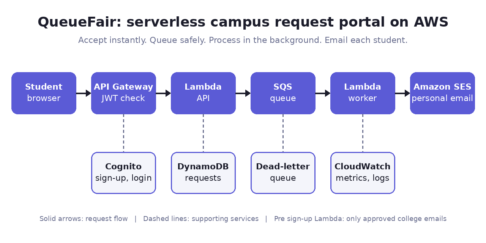
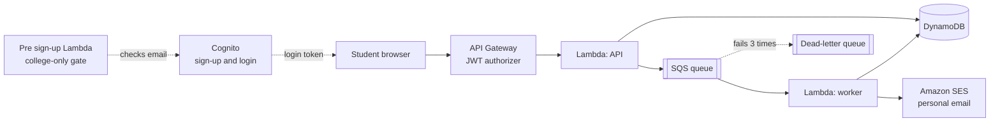
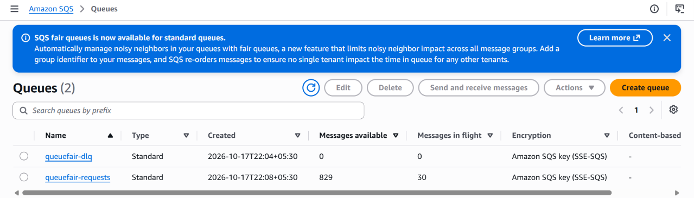
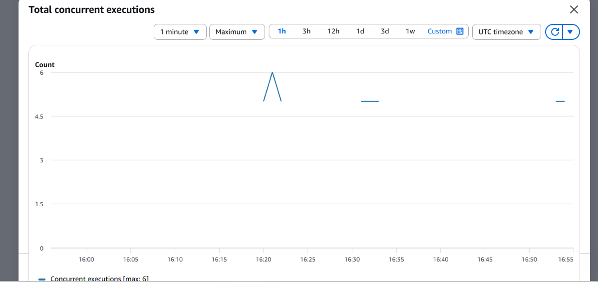
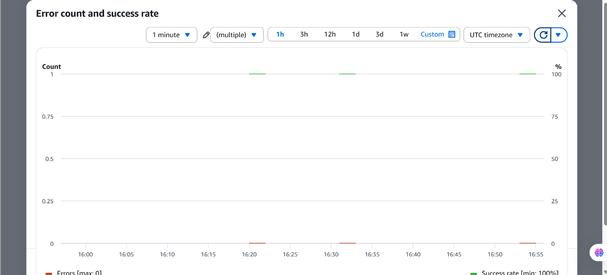
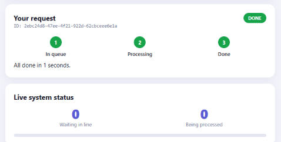
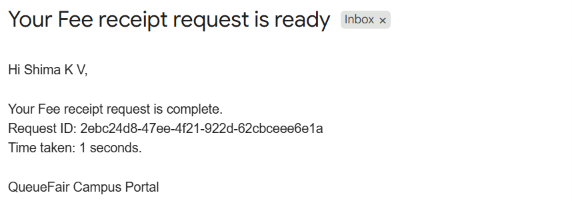

# QueueFair: Serverless Campus Request Portal on AWS

> A serverless portal that stays fast and reliable when thousands of students submit requests at the same time.



**Demo video:** [Watch the 90-second demo](ADD_YOUR_VIDEO_LINK)

## The problem
On deadline days, thousands of students ask the college portal for certificates, fee receipts and lab bookings at once. A normal website tries to finish every job immediately, so it slows down, shows errors or loses requests. It also has no proper login, and notification emails do not reach the right student.

## The solution
QueueFair separates **accepting** a request from **processing** it.

1. A student signs in with a college email (Amazon Cognito).
2. The request is accepted instantly and kept safely in a queue (Amazon SQS).
3. Background workers (AWS Lambda) process it, and more workers start when the line is long.
4. Failed requests are retried, then moved to a dead-letter queue, so nothing is lost.
5. Amazon SES emails the student at their own address when the request is done.

## Architecture


## How one request flows
1. **Sign in:** Cognito verifies the email with a code. A pre sign-up Lambda only allows approved college emails.
2. **Submit:** the page sends the request with a login token. API Gateway checks the token before any code runs.
3. **Save:** the API Lambda reads the student's identity from the verified token and saves the request as `PENDING` in DynamoDB.
4. **Queue:** it puts the request ID in SQS and replies at once.
5. **Process:** a worker marks it `PROCESSING`, then `DONE`. Status changes are conditional, so duplicate messages are harmless.
6. **Notify:** SES emails the student. An email problem never fails the request.
7. **Watch:** the page shows live progress, the queue size and the student's own requests.

## Tech stack
| Service | Role |
|---|---|
| Amazon Cognito | Sign-up, login, email verification, tokens |
| Amazon API Gateway (HTTP API) | Public HTTPS entry point with a JWT authorizer |
| AWS Lambda (Python 3.12) | Page and API, queue workers, sign-up gate |
| Amazon SQS + dead-letter queue | Buffer for rushes, retries, failure handling |
| Amazon DynamoDB | Request records, owner index, 30-day TTL |
| Amazon SES | Personal email to each student |
| Amazon CloudWatch | Metrics and logs |

## Results (load tests)
| Measure | Result |
|---|---|
| Requests processed | 2,956 |
| Peak queue size | 829 waiting, 30 in flight |
| Worker errors | 0 (success rate 100%) |
| Dead-letter queue | 0 |
| Worker concurrency limit | 5 |
| Single request, end to end | DONE in about 1 second |







## Design decisions
- **Queue between API and workers:** absorbs a rush and allows retries. A short delay is better than a failed request.
- **Serverless:** no servers to patch, scales by itself, and costs almost nothing when idle.
- **SES, not SNS, for email:** an SNS email topic only reaches subscribed addresses. SES sends a personal message to any address.
- **Identity from the token, not the form:** the name and email come from the verified login token, so nobody can pretend to be another student.
- **Owner checks:** `/status` and `/my` only return the signed-in student's own requests.
- **Safe repeated processing:** SQS can deliver a message twice, so status updates are conditional and only the worker that finishes a request sends the email.
- **Visibility timeout (3 minutes) is longer than the worker timeout (30 seconds)**, so a message is not handed to a second worker while the first is still busy.

## Problems I hit and how I fixed them
- Wrong queue URL gave `QueueDoesNotExist`. I read the Lambda logs and copied the URL instead of the ARN.
- API Gateway returned `Not Found` because routes had no Lambda integration and there was no `$default` stage.
- The JWT authorizer rejected my issuer URL because the region was missing and I had typed angle brackets.
- Cognito sign-in failed silently because the app client did not allow the `profile` scope.
- Requests stayed `PENDING` because the worker function did not exist yet, and later because the queue visibility timeout was shorter than the worker timeout.
- I found and fixed weaknesses in my own first version: no login, anyone could submit, all emails went to one address, requests saved but never queued, and possible duplicate processing.

## Security
- Cognito login with a verification code, and a college-only sign-up check.
- API Gateway rejects any request without a valid token.
- Each Lambda has its own least-privilege IAM policy (see `iam/`).
- A student can only see their own requests.
- No secrets in the repository. Real ARNs, IDs and URLs are replaced with placeholders.

## Limitations
- The worker's "work" is simulated with a short pause. A real version would generate documents such as certificate PDFs.
- SES is in the sandbox, so it only emails verified addresses until production access is granted.
- A college email proves mailbox ownership, not enrollment. A student roster table would be the stronger check.
- Demo scale, one region, built by hand in the console (no infrastructure as code yet).

## Repository structure
```
src/api/lambda_function.py        Page and API (Lambda)
src/worker/lambda_function.py     Queue worker (Lambda)
src/presignup/lambda_function.py  College-only sign-up gate (Lambda)
iam/                              IAM policies with PASTE_... placeholders
scripts/loadtest.py               Load test script
docs/BUILD_GUIDE.md               Step-by-step build guide
docs/                             Architecture diagram and screenshots
```

## Deploy it yourself
Full steps are in [docs/BUILD_GUIDE.md](docs/BUILD_GUIDE.md). In short: DynamoDB table and index, SQS queue and dead-letter queue, pre sign-up Lambda, Cognito user pool, API Lambda, API Gateway with a JWT authorizer, SES identities, worker Lambda with an SQS trigger, then test and load test.

## Cost
Everything is serverless, so an idle deployment costs very little. Use a billing alert, keep load tests short, close portal tabs when finished, and delete resources you no longer need.

## Roadmap
- CloudWatch alarms and a dashboard (queue backlog, age of oldest message, dead-letter queue, errors)
- Infrastructure as code (Terraform or AWS SAM) and a GitHub Actions deployment pipeline
- Student roster check at sign-up
- Real certificate PDFs stored in Amazon S3

## License
MIT. See [LICENSE](LICENSE).

## Author
**YOUR NAME** · [LinkedIn](ADD_YOUR_LINKEDIN_URL) · [GitHub](ADD_YOUR_GITHUB_URL)
